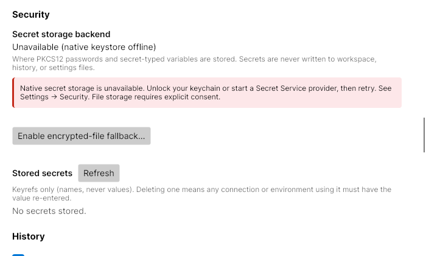
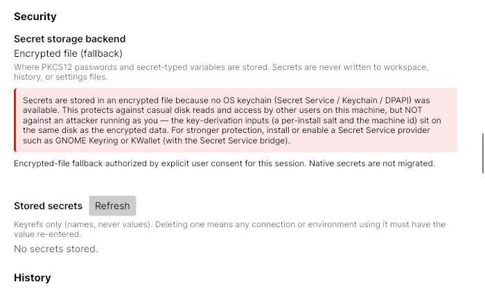

# Secret storage policy

Studio prefers Windows DPAPI, macOS Keychain, or Linux Secret Service. When native storage is unavailable,
new secrets are blocked by default. Operations never silently switch to encrypted-file storage after a
native error. A missing secret and an unavailable backend are different outcomes.

## Consent and recovery

Open **Settings → Security** to see the selected backend and its status. **Retry native keystore** checks
again after unlocking or starting the native service when no backend was selected at startup. A session
that already selected native storage keeps it; simply retry a failed operation after recovery.

**Enable encrypted-file fallback…** explains the limitation and requires confirmation. The encrypted-file
key is derived from machine/user inputs and an on-disk salt: it is weaker than an OS keystore and does not
protect against a process running as you. Consent is persisted before file storage is enabled. A failed
settings write leaves storage blocked. Native secrets are not copied into the fallback.

On upgrade, existing fallback files are retained but require consent before use. A stored reference that
is missing from the selected fallback remains unavailable, including for overwrite/delete; recover the
native keystore and restart Studio. The key-name index is not a list of decrypted or currently readable
values. A corrupt/unreadable index prevents file operations that need to determine reference ownership.

A selected backend stays selected for the session. Restart after changing administrator policy or resetting
saved consent. Resetting all settings clears user consent for subsequent sessions and does not delete
stored secrets or change an already-authorized session's backend.

The Security panel before consent and after explicit authorization (rendered headlessly with an unavailable
native-backend fixture):





## Administrator policy

Provision `secret-policy.json` in an administrator-controlled directory:

| Platform | Path |
|---|---|
| Windows | `%ProgramData%\GrpCurlNet.Studio\secret-policy.json` |
| macOS | `/Library/Application Support/GrpCurlNet.Studio/secret-policy.json` |
| Linux | `/etc/grpcurl-studio/secret-policy.json` |

To prohibit fallback:

```json
{"secretFallback":"block"}
```

The single property accepts `block`, `requireConsent`, or `allow`. `allow` is an explicit administrator
choice of the weaker fallback when native storage is unavailable; working native storage still wins.
`requireConsent` (also the absent-policy default) permits saved or newly confirmed user consent. `block`
overrides saved consent and hides the enable action. A user-level `block` also remains restrictive.
Unreadable, malformed, oversized (>4 KiB), duplicate-key or unknown-key policies block fallback.

User consent is stored in `settings.json` as `security.secretFallback: "Allow"`; a missing setting defaults
to `RequireConsent`. Policy is read once at startup, so restart after policy changes. Unknown native
operation/probe errors are not classified as availability and never authorize a downgrade.

Diagnostics record backend selection, unavailability and the authorization source without secret values
or raw native error text. OS-specific availability classification follows the documented
[Keychain status handling](https://developer.apple.com/documentation/security/keychain_services),
[Secret Service errors](https://gnome.pages.gitlab.gnome.org/libsecret/enum.Error.html), and
[Gio D-Bus errors](https://docs.gtk.org/gio/error.DBusError.html).
