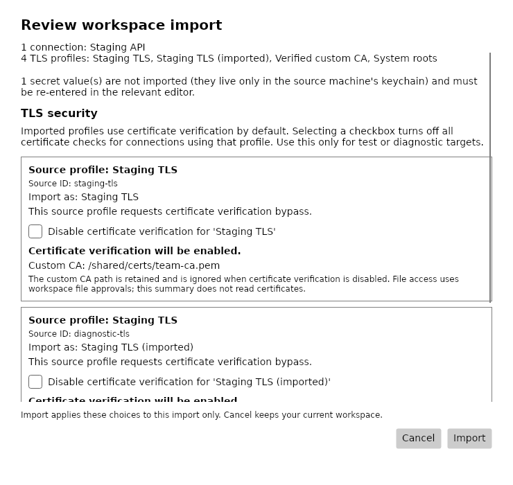
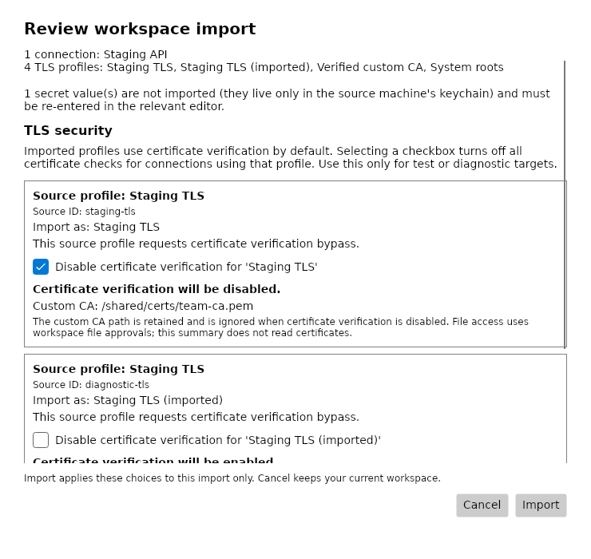

# Workspace import TLS choices

**File → Import Workspace** enables certificate verification for imported profiles by default, including
profiles whose source workspace disables it. Existing profiles in your current workspace keep their settings.

1. Select the workspace to import and complete any [file-reference approvals](workspace-file-approvals.md).
2. Review the item counts, imported names and missing-secret notice. The TLS section identifies each profile
   requesting bypass or configuring a custom CA, with its source ID and destination name.
3. Leave the checkboxes unchecked to verify certificates. To retain bypass for an individual test or
   diagnostic profile, explicitly select **Disable certificate verification for '[profile]'**.
   This turns off all certificate checks for connections using that profile. Profiles already using
   verification have no bypass option.
4. Select **Import**, then optionally supply missing secrets in the existing secret-entry dialog.
   **Cancel** in the import summary cancels the entire import and keeps your current workspace.

Each row shows the resulting verification setting. Duplicate names remain distinguishable by source ID
and the destination's ` (imported)` name suffix.

Custom CA paths are retained when verification is enabled, along with the profile's other TLS settings.
When bypass is selected, the retained custom CA is ignored. The summary displays paths without reading
certificate or descriptor contents. File access continues to use workspace file approvals; a bypass
checkbox does not grant access to files.

These choices apply to this import. The resulting TLS settings persist normally when the workspace is
saved; reopening it keeps those settings. Reimporting the same file starts with unchecked choices again.
Open, Open Recent, Reload and startup keep their existing behavior. The editor's confirmation and the
**INSECURE** banner still apply to profiles with bypass enabled.

No consent metadata is exported or added to `workspace-trust.json`. If review becomes stale or saving
fails, Studio reports the error before writing supplied secrets. See [Troubleshooting](troubleshooting.md)
for changed-source, malformed-ID and partial-save recovery.
