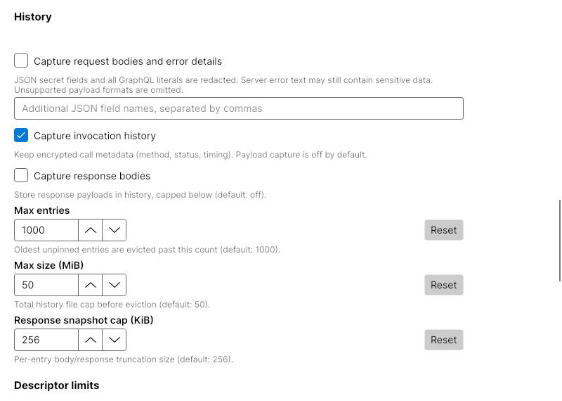
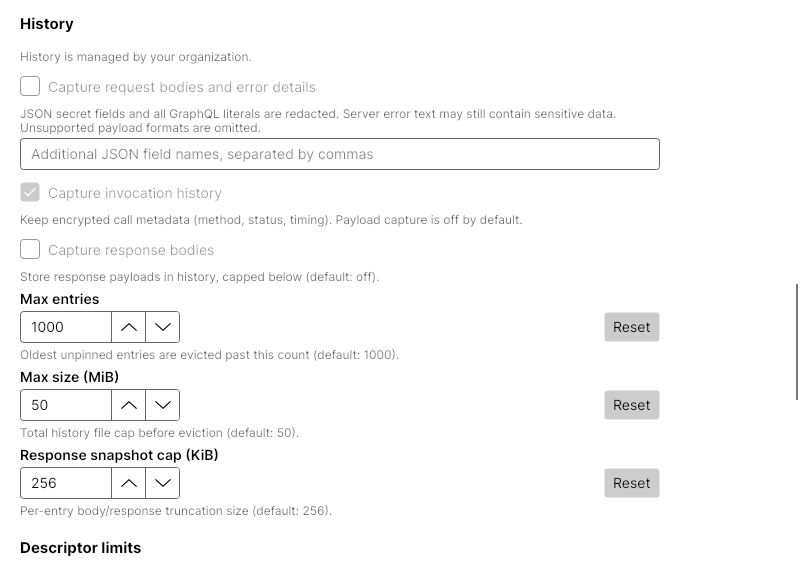
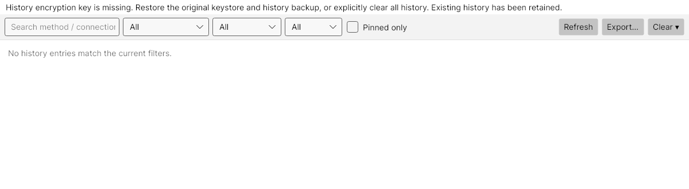

# PRD-007: protected history and capture consent

Default history previously retained request bodies and server error text in plaintext. History now keeps encrypted metadata by default, with independent request/error and response opt-ins. See the [user guide](../articles/studio/history-privacy.md) for policy, migration, export, and recovery.

## Implementation

`HistorySanitizer` gates capture, recursively redacts JSON fields, removes all GraphQL scalar literals/defaults and comments using the parser/lexer, and omits unsupported or malformed payloads. The recorder sanitizes before passing entries to a store; `JsonHistoryStore` independently applies policy/redaction and the UTF-8 cap. The optional `bodyDisposition` field prevents replay of omitted/redacted requests; legacy entries retain version 1 and their original content.

`HistoryCipher` encrypts each line as `enc1:` plus base64(nonce || ciphertext || tag), with a 12-byte random nonce, 16-byte GCM tag, and application/version associated data. A 32-byte key lives at `studio/v1/history/at-rest-key` through the authorized `ISecretStore`. It is resolved per operation, never regenerated over existing encrypted records, and cleared in `finally`. All owned encryption/decryption plaintext arrays use the same lifetime protection. Tests observe actual arrays through an internal instance seam; no production buffer logging or global hooks exist. Strings, UI rows, and cryptographic-library copies remain outside this boundary.

A stable exclusive file handle serializes key initialization and file operations across cooperating processes. There is also an instance operation gate; disposal rejects new calls while admitted work retains the resources it needs. Reads revalidate key access and ciphertext before returning cached objects. Valid legacy/mixed records migrate through atomic replacement, preserving IDs, pins, and payloads. Complete corruption/authentication failures preserve the file and surface a sanitized notice; only incomplete unterminated tails are recoverable automatically. Clear-all can remove unreadable history without accessing a key. Export revalidates records and writes private plaintext only after UI confirmation.

PRD-013 supplied private Unix/Windows permissions, no-follow checks, temporary-file protection, and atomic replacement. This change adds narrow append, stable-lock, delete, and explicit-export operations to that helper. It does not re-claim the earlier permission fix. PRD-039's atomic key-input publication, strict index validation, and buffer cleanup remain intact; PRD-005/006 disposal and fallback admission remain regression gates. Their existing permission-inspection evidence and limitations still apply.

The separate, bounded `history-policy.json` accepts only the three history capture flags. False restricts; true/absent grants no consent. Invalid/unreadable files disable new capture. Policy is enforced by recorder and store without rewriting preferences; rendered controls expose restrictions. Existing records can still be read/migrated/exported/deleted.

## Verification

Local Linux verification:

- Locked restore and Release build: passed, zero warnings/errors.
- Filtered solution tests with coverage: **2,317 passed, 12 platform skips, zero failures**.
- ViewModels coverage: **4,925/5,401 = 91.2%**, above the 80% gate.
- DocFX with warnings as errors: passed.
- Focused history/lifetime suite: 92 passed, one Windows skip. Relevant rendered Settings/History tests: 10 passed.
- Two separate test processes initialized the same fallback-backed history while blocked behind a held lock, then both committed readable records with one indexed key.
- Baseline `df27b91` in an isolated worktree: both representative probes failed as expected (default unary/GraphQL request/error canary retention and plaintext append). The new file-store probe uses the baseline's constructor; assertions are the same as the new default-capture/encrypted-append tests.

Tests cover default and opted-in capture, nested/custom redaction, GraphQL defaults/comments/block strings, invalid formats, Unicode capping, private files/locks/exports, retained legacy bodies/pins, migration failure before/after replacement, lost/wrong/malformed keys, authenticated corruption, incomplete tails, concurrent processes, lock timeout/cancellation, admitted-operation disposal, actual buffer clearing on success/injected failure, strict policy, fallback consent/block-on-restart, replay denial, export confirmation, and rendered recovery.

Screenshots come from the real Avalonia views rendered with Skia in the headless harness; the temporary drawing configuration was restored after capture:

The complete Linux/Windows/macOS CI matrix is required before merge; execution evidence and review status belong in the PR. Local platform skips are not evidence of Windows/macOS execution.

## Remaining boundaries

PRD-014 retention ceilings/pin limits and PRD-047 replay destination identity remain outstanding. GCM authenticates individual records, not ordering, completeness, deletion, or rollback of the history file. There is no history/key/index transaction, portable cross-backend key migration, repair UI, or recovery from guessed ownership. A missing history file remains indistinguishable from empty history. A deleted key with an existing encrypted file fails closed. Old plaintext backups remain sensitive. Cooperating-process locking does not defend against an older client or hostile process running as the same identity.
