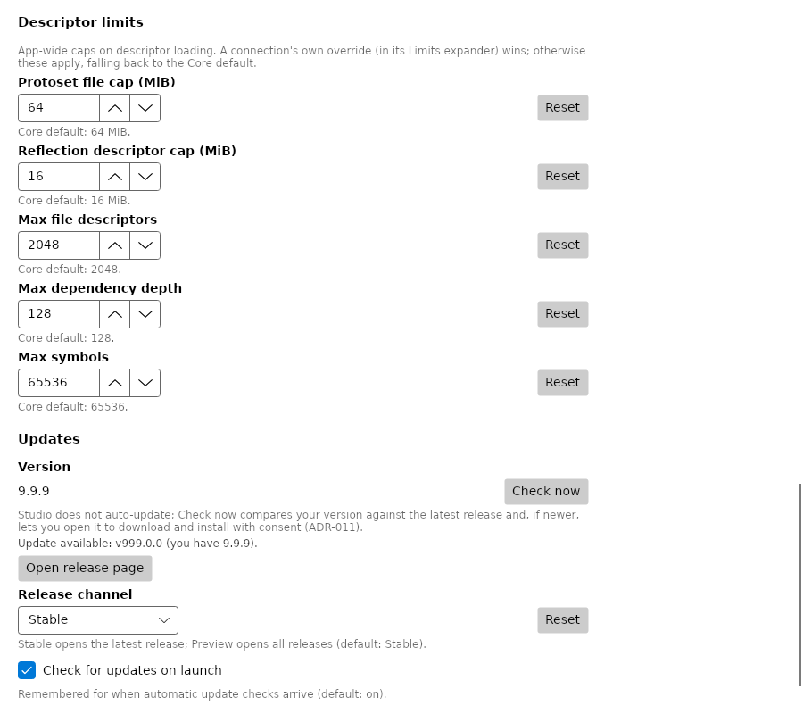
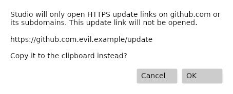

# PRD-025: Update-link validation

Studio accepts update links only when `Uri.TryCreate` parses an absolute HTTPS URL
whose host is `github.com` or ends in `.github.com` (ordinal, case-insensitive).
The dot boundary rejects lookalikes such as `evilgithub.com` and
`github.com.evil.example`; user-info never substitutes for the parsed host.

## Data flow

`UpdateUrlPolicy` is internal to ViewModels and shared with the Studio service.
`UpdateService.ParseReleases` replaces rejected, missing, null or non-string
`html_url` values with an empty string. Version comparison and channel selection
remain unchanged. An available update never automatically opens a browser.

On **Open latest release**, a missing/empty/whitespace URL selects the service's
channel releases page: `/releases/latest` for Stable, `/releases` for Preview.
The Settings view model validates the final target immediately before launching,
including the fallback used by a failed manual check. Failed checks also clear
stale version/link state. A launcher returning false produces an honest status.

A nonempty unsafe URL supplied directly by an update-service implementation is
blocked at this second boundary. The existing **Unsupported link** confirmation
pattern offers copying, never opening. Cancel does neither. Without clipboard
support the status reports the restriction without offering an unavailable action.

## Boundaries

There are no service-signature, persisted-setting, workspace-schema, dependency,
or trust-store changes. The generic launcher remains capable of opening local
folders. Invocation help links keep their existing policy. This is the PRD's
scheme-and-host allowlist: it does not restrict repository paths, ports or user-info
on an otherwise accepted URL, inspect subsequent browser redirects, pin
certificates, download updates, or establish trust in release artifacts.

## Evidence and acceptance

The [isolated baseline](evidence/prd-025-baseline.txt) at `a5e1efa` fails all six
boundary assertions: `file:`, `ms-msdt:` and off-domain HTTPS survive parsing and
reach the fake launcher. No real unsafe URI was launched. The same boundary tests
are retained as regressions. `UpdateUrlPolicyTests` exercises parsing, deceptive
hosts, fallback selection, copy/cancel, missing clipboard and failed-check state.
`UpdateUrlUiTests` drives real Settings controls and the real confirmation dialog.

See the PR description and companion PRD-025 fix-review record for final validation
and independent review status. Implementation evidence is not independent approval.

## Validation-time native crash

The initial full test run exposed the existing exit-139 issue. The user required
a fix, not acceptance of a passing retry. The separate
[PRD-044 correction](PRD-044-native-schema.md) restores libsecret’s complete native
schema layout and adds fail-fast stability verification.

The final Windows matrix then exposed two existing storage-test failures. A local
Windows repetition reproduced concurrent secret-file replacement failing with
`ERROR_ACCESS_DENIED` at `File.Move`. Windows overwrite commits now retry only
error codes 5, 32 and 33, at most ten attempts with 10 ms between attempts. Each
retry rechecks the directory and target protections and reuses the same complete
temporary file. Persistent denial and unrelated failures still preserve the old
file, clean up the owned temporary and report a sanitized error. This is bounded
handling inside the file operation, not a test-run retry or a cross-process
read/modify/write transaction. The original race passed 50 consecutive local
Windows repetitions after this correction. Fault-injection tests cover transient
success, persistent denial, disk-full rejection and temporary-file cleanup.

The cross-process history test exceeded the production five-second lock deadline
under CI load. Its serialization scenario now explicitly uses a 30-second lock
budget and 60-second test coordination budget. The production default remains
five seconds; the separate contention test still verifies timeout, cancellation
and disposal. These validation-driven corrections are separately committed.
