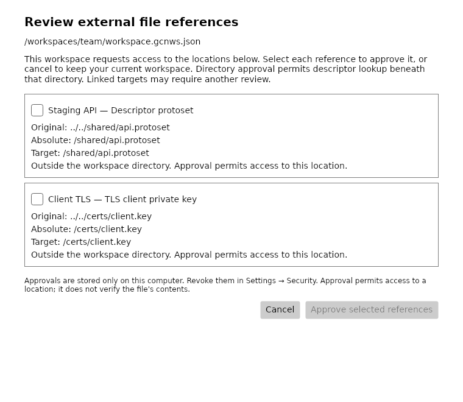
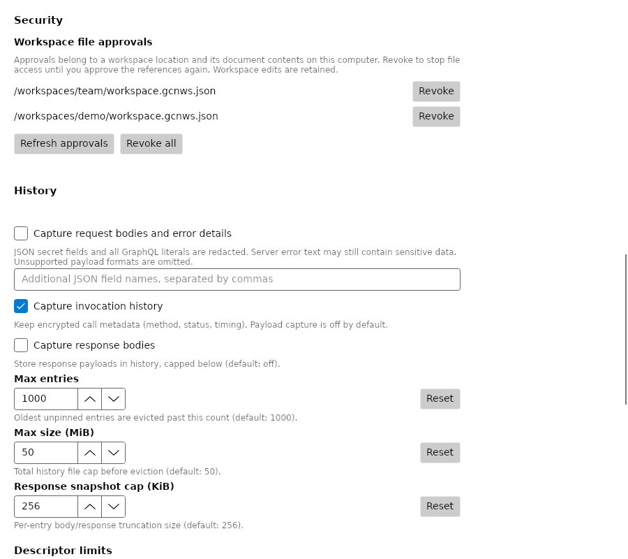

# PRD-026: Workspace file-reference approval and containment

Base: `feature/bug-fixes` at `ebbfd59`. This expands the original import-only issue to direct open, recent-file open, reload, and startup restoration. The workspace schema and exported document format are unchanged. See the [approval and recovery guide](../articles/studio/workspace-file-approvals.md).

## Implementation

`WorkspacePathPortability` owns portable serialization and the shared enumeration/normalization of descriptor and TLS references. `WorkspaceReferenceAssessment` performs component-aware containment, rejects ambiguous platform syntax, resolves symlinks/junctions, and stops before probing unapproved external targets. Descriptor lookup directories are assessed recursively for linked escapes, without opening file contents. A missing ordinary target remains configured; a broken or uninspectable link fails closed.

`IWorkspaceStore` exposes preparation, explicit per-reference consent, validation, and separate open/import commit operations. Preparations are owned by the issuing store and retain an immutable source snapshot; callers receive a cloned preview. Commit rechecks document bytes and resolved targets. Legacy direct store entry points also refuse unapproved references. UI cancellation leaves workspace state, recents, locks, pending autosave, and secrets untouched. Startup defers activation until the shell can present the dialog, and trust failures never take the corrupt-workspace quarantine path.

The private versioned `workspace-trust.json` uses PRD-013's permission/atomic-replacement helper and a stable exclusive writer lock. Records bind canonical location, SHA-256 document fingerprint, individual consent paths, and final resolved reference targets. Intermediate link-inspection consent cannot silently become final-target authorization after retargeting. Studio saves prune removed references and advance admitted fingerprints; imports transfer the final admitted references across ID/path transformations. If a workspace write commits and the approval write fails, the error explicitly reports partial success and access requires approval again.

All Studio descriptor consumers and TLS resolution use `WorkspaceFileAccess`. Core's optional host callbacks run before certificate/key or protoset reads and before compiler directory lookup. CLI callers keep their existing behavior. Studio's compiler path does not add implicit cwd authority. Request validation reauthorizes before consulting its descriptor cache and clears that cache on failure. Operation leases observe cross-instance revocation and cancel work so scoped descriptor sessions/channels unwind and dispose. Settings exposes selective and all-workspace revocation, refresh, and storage recovery errors.

## Baseline and verification

The baseline test file was copied into an isolated detached `ebbfd59` worktree before running it. All six assertions failed because `OpenAsync` accepted traversal without approval: protoset, proto source, import directory, CA certificate, client certificate, and private key. The same six tests pass with this implementation. [Baseline output](evidence/prd-026-baseline.txt).

Tests cover containment, sibling prefixes, traversal, absolute paths, malformed/platform-specific paths, ordinary missing files, links and junctions, linked-directory escapes, changed fingerprints, copied workspaces, retargeted links, restarts, authorized saves, import remapping, corrupt/inaccessible approval storage, partial persistence, selective/all revocation, cross-instance cancellation, actual consumption callbacks, descriptor caches, all five entry points, unchecked defaults, and rendered cancellation/recovery controls.

Local verification:

- Locked restore and Release build passed with zero warnings/errors.
- Filtered solution tests with coverage: 2,370 passed, 14 platform skips, zero failures (headless D-Bus configuration).
- ViewModels line coverage: 4,989/5,476 = 91.1%, above the 80% gate.
- Final focused workspace and shell suite after canonical-alias revocation and partial-success reporting: 169 passed, two Windows-only skips.
- Rendered approval/Settings tests: three passed, including actual checkbox, cancel, revoke, and recovery bindings.
- CLI smoke validation: ten scenarios passed. Core and Studio conformance: 634/634 each.
- DocFX with warnings as errors passed with zero warnings/errors.

The local desktop environment intermittently terminated the Studio test host with native exit code 139,
without an assertion failure. The complete suite passed with `DBUS_SESSION_BUS_ADDRESS=unix:path=/tmp/prd026-no-session-bus`,
matching headless CI conditions; the unchanged baseline Studio suite also passed separately. The native-secret implementation was not changed; the CI matrix remains a required gate.

CI validation results are recorded in the PR. Linux execution does not stand in for Windows/macOS verification. The complete three-OS CI matrix, review approval, and fresh explicit merge authorization remain required before merging.

## Remaining boundaries

This is application-level shared-workspace protection, not a filesystem sandbox against hostile same-user replacement races. Approval grants location access, not trust in file contents. Workspace and auxiliary files still do not form a single transaction. PRD-027 insecure-TLS import consent, PRD-057 imported secret-reference ownership, PRD-033 recent-list network probing, and general transaction fixes are not claimed as resolved.
